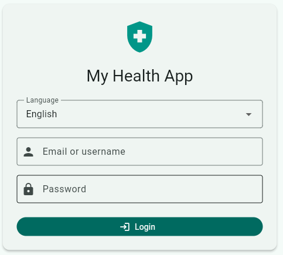
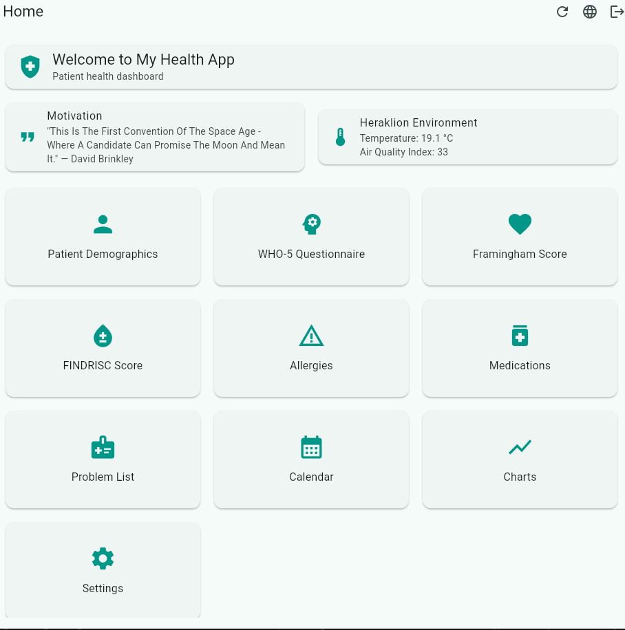
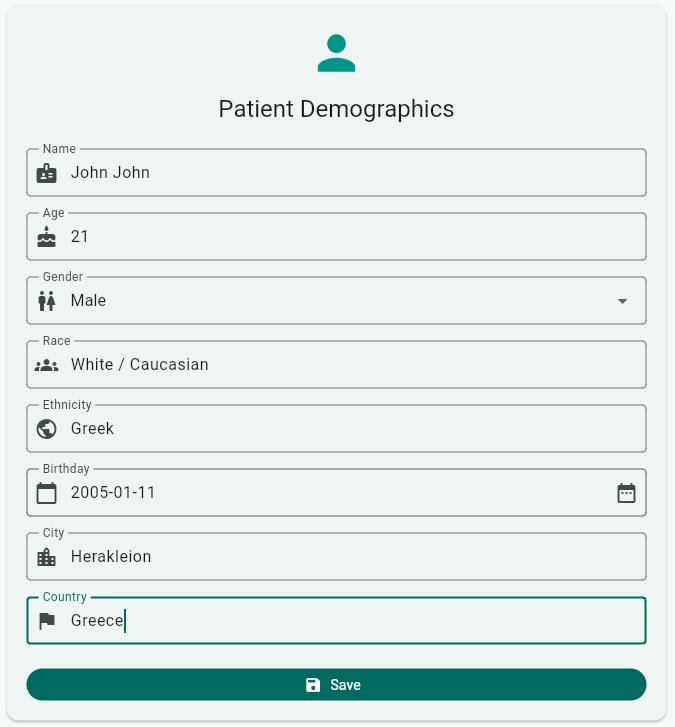
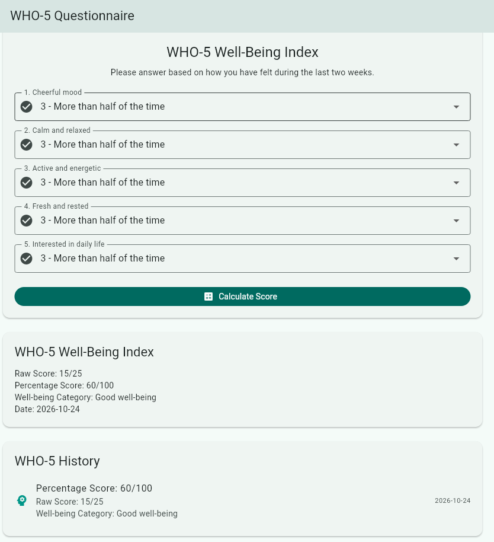
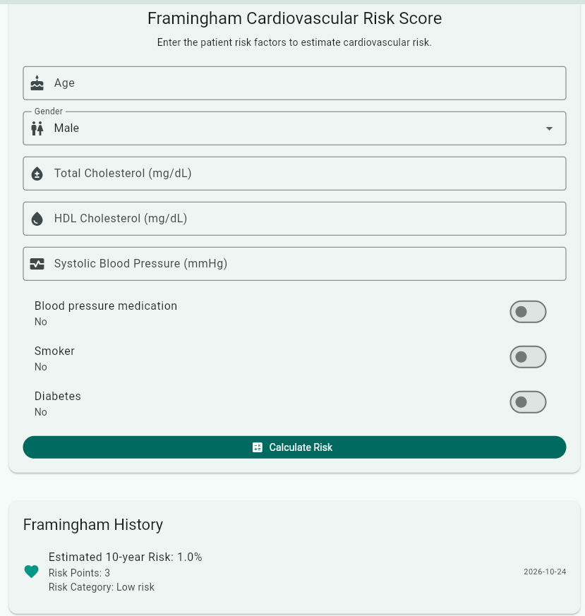
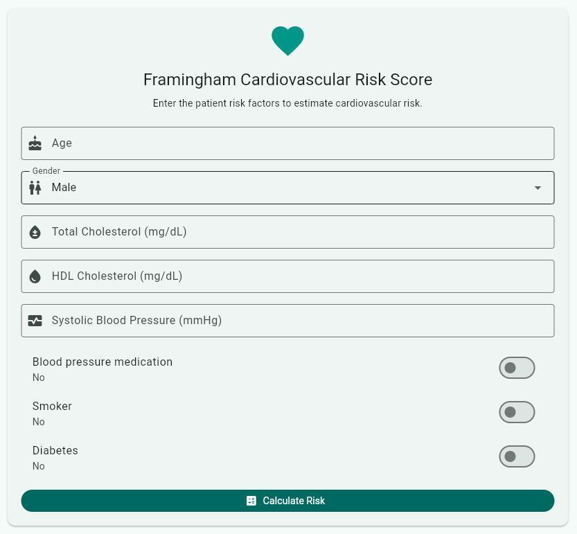
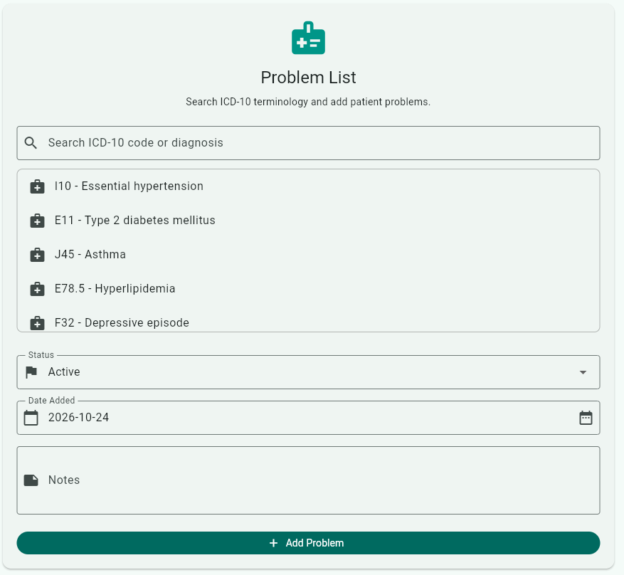
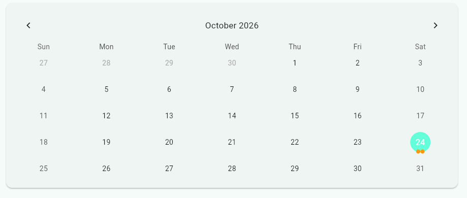
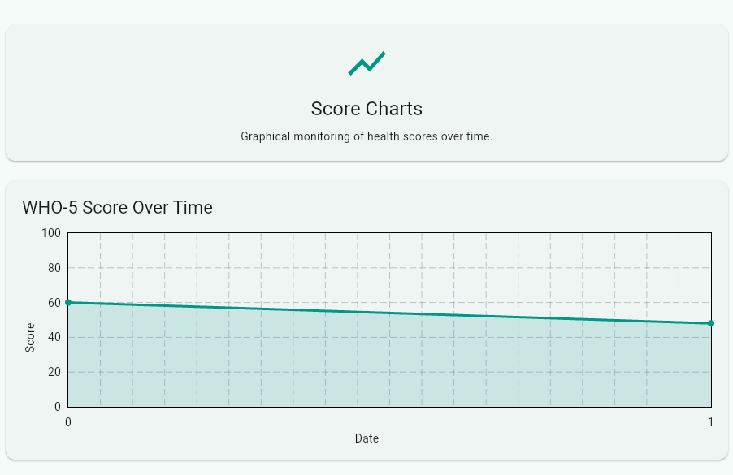
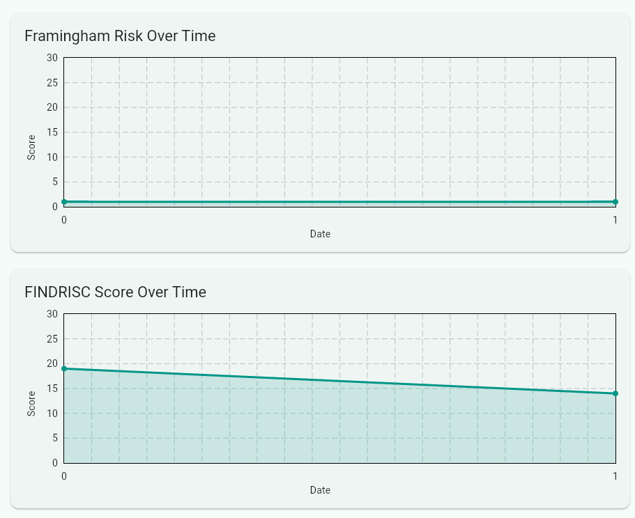

# My Health App

A multilingual mobile health application developed with Flutter and Dart.

The project was originally created as a university project for the **Biomedical Informatics** course and was later reviewed, cleaned up, and prepared for portfolio use.

The application demonstrates health-data management, clinical risk-score calculations, API integration, local persistence, charts, calendar-based event tracking, and multilingual UI support.

## Features

### Authentication UI

- Email or username login form
- Password input
- Basic form validation
- English and Greek language selection

> Authentication is implemented as a local demonstration workflow and does not connect to an external authentication backend.

### Patient Demographics

Users can store basic demographic information such as:

- Name
- Age
- Gender
- Race
- Ethnicity
- Birthday
- City
- Country

### Motivational Message

A motivational quote is retrieved from an external API and displayed on the home dashboard.

The application includes timeout and fallback handling so that API failures do not prevent the rest of the application from functioning.

### Weather and Air Quality

The dashboard retrieves environmental information for Heraklion, Greece, including:

- Temperature
- Air Quality Index (AQI)

Environmental data is retrieved using the Open-Meteo APIs.

### WHO-5 Well-Being Index

Implementation of the WHO-5 questionnaire including:

- Five-question assessment
- Automatic score calculation
- Percentage score
- Result interpretation
- Local result history
- Calendar integration

### Framingham Cardiovascular Risk Score

The application provides a Framingham-style cardiovascular risk calculator based on factors such as:

- Age
- Gender
- Total cholesterol
- HDL cholesterol
- Systolic blood pressure
- Blood-pressure treatment
- Smoking
- Diabetes

Calculated results are stored locally together with their date.

> This implementation is intended for educational and demonstration purposes and should not be used for clinical decision-making.

### FINDRISC

Implementation of the Finnish Diabetes Risk Score using factors including:

- Age
- BMI
- Waist circumference
- Physical activity
- Fruit and vegetable consumption
- Blood-pressure medication
- History of high blood glucose
- Family history of diabetes

Results are stored locally and can be monitored over time.

### Allergies

Users can:

- Add allergies
- View stored allergies
- Delete allergy records

Each record can contain:

- Allergen
- Reaction
- Severity
- Onset date
- Notes

### Medications

Medication management includes:

- Medication name
- Dosage
- Frequency
- Start date
- End date
- Ongoing treatment status
- Notes
- Current medication list
- Medication history

### Problem List

The application includes a health problem list with local ICD-10 lookup support.

Each entry can contain:

- ICD-10 code
- Diagnosis or problem title
- Status
- Date added
- Notes

The included ICD dataset is intended as a demonstration subset rather than a complete ICD-10 database.

### Calendar

Health-related events from different modules are automatically integrated into a calendar.

Examples include:

- WHO-5 assessments
- Framingham calculations
- FINDRISC calculations
- Allergies
- Medications
- Problem-list entries

Manual calendar events can also be created.

### Charts

Historical score data can be visualized using line charts for:

- WHO-5
- Framingham
- FINDRISC

### Multilingual Support

The application currently supports:

- English
- Greek

The selected language is stored locally and restored between application sessions.

---

## Technology Stack

- Flutter
- Dart
- Material 3
- HTTP
- SharedPreferences
- fl_chart
- table_calendar
- Open-Meteo APIs
- DummyJSON Quotes API

---

## Architecture

The application is organized into separate screens, models, services, constants, and localization logic.

```text
lib/
├── core/
│   ├── constants/
│   └── services/
├── localization/
├── models/
├── screens/
└── main.dart
```

### Models

Data models are used for application entities such as:

- Patient demographics
- WHO-5 results
- Framingham results
- FINDRISC results
- Allergies
- Medications
- Health problems
- Calendar events

Most stored models support serialization using `toMap()` and `fromMap()`.

### Services

Application logic is separated from the UI through service classes responsible for:

- API communication
- Local persistence
- Clinical score calculation
- Calendar-event creation
- Language preferences

---

## Local Data Storage

The application uses `SharedPreferences` for lightweight local persistence.

Structured records are serialized to JSON before being stored.

This approach was selected for the scope of the original university project because the amount of locally stored data is relatively small and does not require a full relational database.

For a production-scale health application, a dedicated local database such as SQLite/Drift or another structured persistence solution would be more appropriate.

---

## Project Status

The original university implementation was reviewed and tested using a modern Flutter environment.

Current development environment:

```text
Flutter 3.44.0
Dart 3.12.0
```

The application currently passes:

```bash
flutter analyze
```

with:

```text
No issues found!
```

The main workflows were also functionally tested in Flutter Web using Google Chrome.

---

## Running the Project

### Requirements

- Flutter SDK
- Dart SDK
- Google Chrome, Android emulator/device, or another supported Flutter target

Check your Flutter installation:

```bash
flutter doctor
```

Install dependencies:

```bash
flutter pub get
```

Run static analysis:

```bash
flutter analyze
```

Run the application in Chrome:

```bash
flutter run -d chrome
```

Alternatively:

```bash
flutter run
```

and select one of the available target devices.

---

## Screenshots

### Login



### Home Dashboard



### Patient Demographics



### WHO-5 Well-Being Index



### Framingham Cardiovascular Risk Score



### FINDRISC



### ICD-10 Problem List



### Calendar



### Score Monitoring





---

## Educational Context

This project was originally developed as part of a university **Biomedical Informatics** course.

The original assignment required a multilingual Flutter health application including authentication, patient demographics, motivational and environmental APIs, health questionnaires, clinical risk calculators, local health-data storage, graphical score monitoring, ICD terminology, medication and allergy management, and calendar integration.

The repository version preserves the original application concept while including compatibility and code-quality cleanup for current Flutter tooling.

---

## Limitations

This project is an educational prototype and not a production medical application.

Current limitations include:

- No real authentication backend
- No encrypted health-data storage
- `SharedPreferences` instead of a dedicated local database
- Demonstration subset of ICD-10 terminology
- No cloud synchronization
- No production-grade state-management architecture
- No automated test suite yet
- Clinical calculators are provided for educational purposes only

---

## Possible Future Improvements

Potential future improvements include:

- SQLite / Drift local database
- Provider, Riverpod, or BLoC state management
- Official Flutter localization using ARB files
- Real authentication
- Full ICD terminology dataset
- Unit and widget tests
- Repository and dependency-injection layers
- Improved accessibility
- More responsive mobile and desktop layouts

---

## Author

**Vasileios Troupis**

Computer Engineering student

GitHub: `Arioner923`